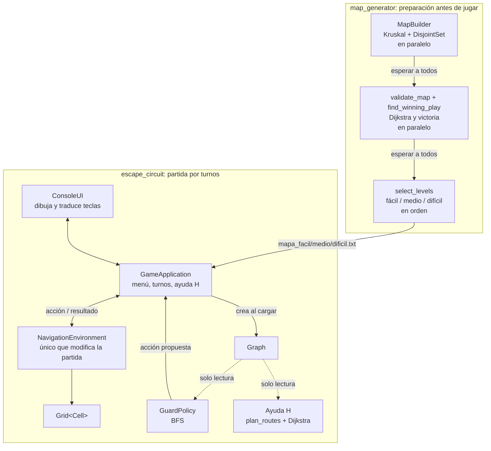

# Circuito de Escape — Proyecto 2 (CS2013 Programación III, 2026-2)

[](https://github.com/SaulMoralesZ/cs2013-2026-2-proyecto-1-grupo3-EquipoDinamita/actions/workflows/build.yml)

Juego de laberinto por turnos en consola. El jugador 🤖 debe **activar los interruptores A y B,
en cualquier orden, y llegar a la salida 🚪 con energía restante**, sin que lo atrape el
vigilante 👾 y dentro del límite de turnos. Cada movimiento cuesta la energía de la casilla a la
que se entra; las baterías 🔋 recargan, las trampas 💀 quitan y los recursos 💎 dan puntos.

El proyecto amplía el motor del Proyecto 1 con:

- **Generación de mapas con Kruskal** (`DisjointSet` propio) y aperturas adicionales.
- **Validación de rutas y costos con Dijkstra** (propio) y **partida ganadora comprobada**.
- **Clasificación en tres niveles** (fácil, medio, difícil) según el costo de energía.
- **Preparación concurrente** de hasta 10 mapas con `std::jthread`, en dos fases separadas.
- **Vigilante que persigue con BFS** (propio) en los turnos pares.
- **Ayuda de energía H** con Dijkstra, recalculada desde la posición actual sin avanzar turnos.
- Menú, partidas guardadas, reproducción de la solución, instalador y versión portable.

El README del Proyecto 1 se conserva en [`README (viejo-proyecto1).md`](README%20%28viejo-proyecto1%29.md).

---

## Contenido

1. [Descargar, instalar y desinstalar](#1-descargar-instalar-y-desinstalar)
2. [Cómo jugar](#2-cómo-jugar)
3. [Compilar desde el código](#3-compilar-desde-el-código)
4. [Pruebas](#4-pruebas)
5. [Preparar mapas: `map_generator` y semillas](#5-preparar-mapas-map_generator-y-semillas)
6. [Opciones de `escape_circuit`](#6-opciones-de-escape_circuit)
7. [Formatos de archivo](#7-formatos-de-archivo)
8. [Arquitectura](#8-arquitectura)
9. [Estructura de carpetas](#9-estructura-de-carpetas)
10. [Archivos del código](#10-archivos-del-código)
11. [Reutilización del Proyecto 1](#11-reutilización-del-proyecto-1)
12. [Algoritmos y concurrencia](#12-algoritmos-y-concurrencia)
13. [Generar los paquetes](#13-generar-los-paquetes)
14. [Limitaciones conocidas](#14-limitaciones-conocidas)
15. [Equipo](#15-equipo)

---

## 1. Descargar, instalar y desinstalar

**Sistema de la demostración: Ubuntu 26.04 (Linux x86-64).** También hay instalador y versión
portable para **Windows 10/11 x64**. Ninguna opción requiere compilar ni instalar dependencias:
los ejecutables son estáticos y el paquete incluye los mapas.

Los paquetes se generan en cada push a `main` con GitHub Actions: pestaña **Actions** →
ejecución más reciente de *Compilar y empaquetar* (en verde) → sección **Artifacts**:

| Artefacto | Contiene |
|---|---|
| `escape-circuit-linux` | `escape-circuit_1.0.0_amd64.deb` (instalador) y `escape-circuit-1.0.0-linux-x86_64.tar.gz` (portable) |
| `escape-circuit-windows` | `escape-circuit-1.0.0-windows-x86_64.exe` (instalador) y `escape-circuit-1.0.0-windows-x86_64.zip` (portable) |

También se pueden generar localmente (ver [sección 13](#13-generar-los-paquetes)).

### Linux (Ubuntu / Debian) — instalador `.deb`

```bash
# Instalar
sudo apt install ./escape-circuit_1.0.0_amd64.deb

# Ejecutar: buscar "Circuito de Escape" en el menú de aplicaciones, o en una terminal:
escape_circuit          # juego (abre el menú)
map_generator --help    # generador de mapas

# Desinstalar
sudo apt remove escape-circuit
```

Se instala en `/usr/bin` (ejecutables), `/usr/share/escape_circuit/assets/maps` (mapas),
`/usr/share/applications` (acceso del menú) y `/usr/share/icons` (ícono). Al desinstalar se
conservan las partidas guardadas del usuario en `~/.local/share/escape_circuit/`.

### Linux — portable `.tar.gz`

```bash
tar -xzf escape-circuit-1.0.0-linux-x86_64.tar.gz
./escape-circuit-1.0.0-linux-x86_64/bin/escape_circuit
```

Para "desinstalar", basta con borrar la carpeta.

### Windows — instalador `.exe` o portable `.zip`

- **Instalador:** ejecutar `escape-circuit-1.0.0-windows-x86_64.exe` (Siguiente → Instalar).
  Crea "Circuito de Escape" en el menú Inicio y en el escritorio. Se desinstala desde
  *Configuración → Aplicaciones → Circuito de Escape → Desinstalar*.
- **Portable:** descomprimir el `.zip` y hacer doble clic en `escape_circuit.exe`.

El `LEEME.txt` incluido resume el uso. Los datos del usuario van en `%APPDATA%\escape_circuit\`.

### Doble clic: el juego abre su propia terminal

- **Linux:** si se abre sin terminal (menú de aplicaciones o gestor de archivos), el juego se
  vuelve a ejecutar dentro de una terminal instalada: primero `$TERMINAL`, luego
  `x-terminal-emulator` y una lista de emuladores conocidos (ptyxis, gnome-terminal, konsole,
  xterm…).
- **Windows:** un `.exe` de consola abre su ventana; el juego activa UTF-8 y, si la consola no es
  *Windows Terminal*, usa símbolos ASCII en lugar de emojis.

---

## 2. Cómo jugar

Al ejecutar `escape_circuit` aparece el menú (flechas o W/S y Enter):

| Opción | Qué hace |
|---|---|
| **Jugar** | Elige fácil, medio o difícil del lote preparado y empieza la partida. |
| **Ver partida guardada** | Reproduce una partida propia guardada con **G** al terminar. |
| **Ver solución del mapa** | Reproduce la victoria comprobada por el generador para ese nivel. |
| **Cómo jugar** | Reglas, controles y leyenda de símbolos. |
| **Salir** | Cierra el juego. |

### Reglas

- Pisar un interruptor lo activa y queda activado. La salida se puede pisar antes, pero solo
  permite escapar con **A y B activos**, **energía positiva** y **dentro del límite de turnos**
  (el último turno permitido cuenta).
- Moverse cuesta la energía de la casilla destino (normal 1, terreno elevado 2). Esperar o chocar
  con un muro cuesta 1. Llegar a la salida con energía 0 no gana.
- **El vigilante** conoce tu posición, recalcula con BFS y avanza una casilla en los **turnos
  pares**; en los impares espera. Si te alcanza, pierdes, incluso sobre la salida (la captura
  tiene prioridad sobre el escape).

### Controles

| Tecla | Acción |
|---|---|
| W A S D / flechas | Mover |
| E | Esperar un turno |
| H | Ayuda de energía (Dijkstra). Mientras está abierta no pasa ningún turno |
| 1 / 2 / 3 (con H abierta) | Resaltar el camino hacia A / hacia B / el recorrido completo |
| R | Reiniciar la partida (`reset`) |
| G (al terminar) | Guardar la partida |
| + / − | Agrandar / achicar el tablero (zoom 1 a 4, se ajusta solo a la ventana) |
| M / Q | Volver al menú |

### Ayuda de energía (H)

Se calcula **al abrirla**, desde la posición, la energía y los interruptores actuales:

```
Objetivo  Estado            Gasto desde aqui
A         Pendiente         8
B         Pendiente         2
Salida    Requiere A y B    —

Recorrido: posicion actual -> B -> A -> salida
Energia disponible: 12   Gasto total: 10   Quedarian: 2
Estado: ALCANZA PARA ESTE RECORRIDO SIN VIGILANTE
```

Compara los dos órdenes posibles, omite los interruptores ya activados, distingue energía
suficiente, justa (llegaría con 0) e insuficiente, y muestra *Destino inaccesible* si no hay
camino. No anticipa al vigilante ni las recargas.

### Símbolos

| Emoji | ASCII | Significado |
|---|---|---|
| 🤖 | `@` | jugador |
| 👾 | `G` | vigilante |
| 🔴 / 🟢 | `!` / `+` | interruptor pendiente / activado |
| 🚪 | `S` | salida |
| 🧱 | `#` | muro |
| ⬜ | `.` | libre |
| 🪨 | `~` | terreno elevado |
| 🔋 | `B` | batería |
| 💀 | `T` | trampa |
| 💎 | `R` | recurso |

---

## 3. Compilar desde el código

**Requisitos:** CMake ≥ 3.20 y un compilador C++20 (GCC 12+, Clang 15+ o Visual Studio 2022).
[FTXUI](https://github.com/ArthurSonzogni/FTXUI) 7.0.3 se descarga sola con `FetchContent`.

```bash
# Ubuntu / Debian
sudo apt install cmake g++ git

# Compilar (desde la raíz del repositorio)
cmake -S . -B build
cmake --build build -j8

# Versión optimizada (recomendada para generar mapas grandes)
cmake -S . -B build-release -DCMAKE_BUILD_TYPE=Release
cmake --build build-release -j8
```

En Windows con Visual Studio: `cmake -S . -B build -A x64` y `cmake --build build --config Release`.

| Opción de CMake | Por defecto | Efecto |
|---|---|---|
| `CIRCUIT_ESCAPE_WITH_UI` | `ON` | `OFF` compila solo la biblioteca, el generador y las pruebas sin FTXUI |
| `CIRCUIT_ESCAPE_STATIC` | `OFF` | Ejecutables estáticos (sin dependencias del sistema); lo usan los paquetes |
| `CMAKE_BUILD_TYPE` | — | `Release` para optimizar |

Resultado: `build/escape_circuit` (juego), `build/map_generator` (generador) y las pruebas. Ambos
ejecutables enlazan la biblioteca compartida `escape_core`.

---

## 4. Pruebas

```bash
ctest --test-dir build --output-on-failure     # las 20 pruebas
ctest --test-dir build -R pathfinding          # solo una
```

GitHub Actions ejecuta las 20 pruebas en **Linux y Windows** en cada push. Las pruebas usan
`assert` con `#undef NDEBUG`, así que también comprueban en Release.

| Prueba | Qué verifica | Evidencia (§7) |
|---|---|---|
| `grid_test` | `Grid` con dimensiones en ejecución, límites, iteradores y utilidades genéricas | Dimensiones configurables |
| `environment_test`, `interactions_test` | Motor del Proyecto 1: movimiento, energía, baterías, trampas, recursos, reinicio | Reinicio, espera, movimiento inválido, energía agotada |
| `controllers_test` | `IController`, concept, `PolicyController`, políticas aleatoria y heurística | Reutilización de controladores |
| `scenario_test` | Validación del escenario (posiciones, salida, reglas) y `entry_cost` | Rechazo de escenarios inválidos |
| `observation_test` | La observación incluye mapa, interruptores y vigilante | Contrato del vigilante |
| `turn_test` | Orden del turno, A y B en ambos órdenes, salida anticipada, captura, prioridad, límite y último turno | Interruptores y salida, captura en la salida, límite de turnos |
| `graph_test` | `Graph` desde `Grid` y `DisjointSet` | Grafo y DisjointSet propios |
| `map_builder_test` | Kruskal: árbol sin ciclos (casillas−1 aperturas), aperturas adicionales separadas, misma semilla = mismo mapa, guardar/cargar, mapas 10×15, 20×30 y 40×60 jugables, rechazo de dimensiones inválidas | Kruskal, dimensiones configurables |
| `pathfinding_test` | Dijkstra y BFS: ejemplo del enunciado (A=8, B=2, total 10), inaccesibles, desempate fijo, Dijkstra = BFS con costo 1 | Dijkstra y ayuda H |
| `map_validator_test` | Ambos recorridos (22 y 10), energía suficiente/cero/insuficiente, recargas, objetivos inaccesibles | Dijkstra en la validación |
| `winning_play_test` | Partida ganadora reproducible con el motor real, recargas obligatorias, último turno, vigilante que bloquea | Partida completa |
| `map_selector_test` | Costos 10/18/32 → promedio 20, intermedios 18 y 21, empates por id, lote sin tres costos, orden de llegada | Niveles de dificultad |
| `map_batch_test` | Mismos mapas, costos, recorridos y niveles con 1, 2, 3, 4, 10 y 16 trabajadores; paralelismo real; fases separadas; lote vacío; fallo de una tarea | Concurrencia |
| `guard_controller_test` | BFS hacia la posición actual, muros, desempate fijo, solo turnos pares, espera sin camino, captura | Vigilante |
| `energy_help_test` | Tabla de la ayuda H línea por línea, saldo, actualización tras moverse, sin avanzar turnos | Dijkstra y ayuda H |
| `level_catalog_test` | Carga de los tres niveles, reproducción de la victoria guardada y `reset` | Partida completa, reinicio |
| `game_record_test` | Guardar y reproducir una partida jugada (mismo resultado, turnos y energía) | Partida completa |
| `launch_test` | Rutas relativas al ejecutable, carpeta del usuario y elección de la terminal | Instalador |
| `ui_test` | Traducción de teclas, H sin avanzar turnos, tamaño del tablero con zoom, marco de tamaño fijo | Ayuda H, interfaz |

`demo_environment` (`tests/test1-1.cpp`) es un programa de demostración del Proyecto 1, no una prueba.

---

## 5. Preparar mapas: `map_generator` y semillas

`map_generator` prepara un **lote** de alternativas con las mismas dimensiones y reglas, las
valida, comprueba una partida ganadora y guarda **un mapa por nivel**:

```bash
./build/map_generator                                        # 10×15, semilla 42, 10 mapas
./build/map_generator --rows 20 --cols 30 --energy 150 --turns 300
./build/map_generator --rows 40 --cols 60 --energy 400 --turns 800 --workers 8
```

| Opción | Por defecto | Descripción |
|---|---|---|
| `--rows`, `--cols` | 10, 15 | Dimensiones (se rechazan nulas, negativas, > 100 o sin espacio para los elementos) |
| `--seed` | 42 | Semilla base: el mapa con id *i* usa `seed + i − 1` |
| `--count` | 10 | Alternativas del lote (1 a 10) |
| `--workers` | núcleos | Trabajadores `std::jthread` (1 = secuencial) |
| `--energy`, `--turns` | 60, 180 | Energía inicial y máxima; límite de turnos |
| `--resources`, `--batteries`, `--traps` | 3, 2, 2 | Elementos a colocar |
| `--out` | ver abajo | Carpeta de salida |

**Salida:** `mapa_facil.txt`, `mapa_medio.txt` y `mapa_dificil.txt`. Sin `--out`, se guardan en
la carpeta de mapas del juego si se puede escribir (repositorio o carpeta portable); si no
(instalado en `/usr`), en `~/.local/share/escape_circuit/maps/` o `%APPDATA%\escape_circuit\maps\`.
El juego prefiere los mapas del usuario cuando existen los tres niveles.

**Semillas y reproducibilidad.** Con la misma semilla, dimensiones y reglas, el lote produce
siempre los mismos mapas, costos, partidas ganadoras y niveles por identificador, **con
cualquier cantidad de trabajadores** (probado en `map_batch_test`). El generador aleatorio es
`std::mt19937`, cuya salida fija el estándar, y la mezcla es propia (no `std::shuffle`, que
depende de la implementación). Cada archivo guarda su `id` y su `seed`.

Ejemplo de salida:

```
Lote de 10 alternativas 10x15 (semilla base 42) con 8 trabajador(es)
Mapa 3 (semilla 44) construido por T3, validado por T3
  kruskal: arbol 39 aperturas, 2 adicionales
  validacion: aceptado - recorrido origen -> B -> A -> salida, costo 22, energia 60: alcanza y queda energia
  partida ganadora: 20 turnos, energia final 41, baterias usadas 1 (20 estados explorados)
  resultado: ACEPTADO - victoria en 20 turnos
...
Tiempos: construccion 1.5 ms, validacion 86.9 ms, clasificacion 5.6 ms
Mapas con victoria comprobada: 5 de 10 (costo promedio 29.6)
  Facil: mapa 3 (costo 22) -> assets/maps/mapa_facil.txt
  Medio: mapa 6 (costo 29) -> assets/maps/mapa_medio.txt
  Dificil: mapa 5 (costo 38) -> assets/maps/mapa_dificil.txt
```

Si el lote no tiene tres costos distintos, informa que debe regenerarse con otra semilla o
configuración; si no hay mapas con victoria comprobada, detiene la preparación.

---

## 6. Opciones de `escape_circuit`

| Opción | Descripción |
|---|---|
| *(ninguna)* | Abre el menú |
| `--level facil\|medio\|dificil` | Juega directamente ese nivel del lote |
| `--map <ruta>` | Juega un escenario generado (con A, B y vigilante) |
| `--scenario <ruta>` | Juega un mapa del Proyecto 1 (sin interruptores) |
| `--difficulty easy\|standard\|hard` | Reglas para `--scenario` |
| `--maps-dir <carpeta>` | Lote de niveles a usar (por defecto: el incluido o el del usuario) |
| `--saves-dir <carpeta>` | Carpeta de partidas guardadas |
| `--ascii` / `--emoji` | Forzar símbolos ASCII o emojis |
| `--controller random\|heuristic`, `--seed <n>` | Juega una política automática (Proyecto 1) |
| `--help` | Ayuda |

---

## 7. Formatos de archivo

### Escenario (`mapa_*.txt`)

Texto plano con cabecera `clave: valor` y la cuadrícula al final. Lo escribe `map_generator` y lo
carga el juego, que crea `Grid` con las filas y columnas del archivo, sin recompilar.

```
rows: 10
cols: 15
id: 3
seed: 44
level: easy
min_cost: 22
energy_initial: 60
energy_max: 60
turn_limit: 180
base_cost: 1
rough_cost: 2
wait_cost: 1
invalid_cost: 1
resource_points: 10
battery_recharge: 3
trap_energy_penalty: 2
trap_score_penalty: 1
start: 4 4
switch_a: 5 0
switch_b: 3 6
exit: 2 2
vigilante: 4 9
winning_play: RRUDLLUULLLLDDDUUURR
grid:
.T.#..~..B.#.~.
T#########.###R
...
```

| Clave | Contenido |
|---|---|
| `rows`, `cols` | Dimensiones; deben coincidir con la cuadrícula |
| `id`, `seed` | Identificador del mapa en su lote y semilla usada |
| `level`, `min_cost` | Nivel (`easy`, `standard` = medio, `hard`) y costo mínimo calculado con Dijkstra |
| `energy_initial`, `energy_max`, `turn_limit` | Energía y límite de turnos |
| `base_cost`, `rough_cost`, `wait_cost`, `invalid_cost` | Costos de entrada y de esperar o chocar |
| `resource_points`, `battery_recharge`, `trap_*` | Valores de recursos, baterías y trampas |
| `start`, `switch_a`, `switch_b`, `exit`, `vigilante` | Posiciones iniciales (`fila columna`) |
| `winning_play` | Partida ganadora comprobada: `U` arriba, `D` abajo, `L` izquierda, `R` derecha, `W` esperar |
| `grid:` | Cuadrícula: `#` muro, `.` libre, `~` terreno elevado, `R` recurso, `B` batería, `T` trampa, `S` salida, `@` inicio |

Al cargar se rechaza, con un mensaje claro, cualquier clave o símbolo desconocido, filas de
distinto ancho o `rows`/`cols` que no coincidan. Las líneas que empiezan con `#` antes de `grid:`
son comentarios. Los mapas del Proyecto 1 (`scenario_01.txt`, `scenario_02.txt`) usan solo la
cuadrícula con `@`.

### Partida guardada (`partida_AAAAMMDD_HHMMSS.txt`)

Se guarda con **G** al terminar una partida. Como el motor y el vigilante son deterministas,
basta guardar una acción por turno; el archivo **incluye el mapa completo**, así que se puede
reproducir aunque después se regenere el lote.

```
resultado: victoria
turnos: 20
energia_final: 41
fecha: 2026-11-23 12:36:21
acciones: RRUDLLUULLLLDDDUUURR
mapa:
rows: 10
...            (escenario completo, mismo formato de arriba)
```

`resultado` es `victoria`, `capturado`, `sin_energia`, `limite_turnos` o `en_curso`.

---

## 8. Arquitectura



- **`NavigationEnvironment` es el único que modifica la partida.** El turno se divide en
  `step_player` → `step_guard` (solo en turnos pares) → `finish_turn`; `play_turn` los llama en
  ese orden y pide la decisión al vigilante.
- **El vigilante y la ayuda reciben datos de solo lectura.** El vigilante es un `IController`
  (`PolicyController<GuardPolicy>`): propone una acción y el motor la valida.
- **Una sola implementación de Dijkstra** (`pathfinding/dijkstra`) la usan la validación de mapas,
  la búsqueda de la partida ganadora y la ayuda H, a través de `plan_routes`.
- **La biblioteca `escape_core` no depende de FTXUI.** La interfaz está en `circuit_escape_ui`.
  Por eso toda la lógica (incluidas la ayuda H, las partidas guardadas y el lanzador) se prueba
  sin terminal.

### Orden del turno (§3.2)

1. `step_player(acción)`: el jugador mueve o espera; el motor aplica costos e interacciones y
   comprueba la **captura inicial** (el jugador entró en la casilla del vigilante).
2. `step_guard(acción)`: solo en turnos pares (contados desde 1); el motor valida la acción contra
   `guard_legal_actions()`. El vigilante no gasta energía del jugador ni recoge nada.
3. `finish_turn()`: **captura** → **energía agotada** → **activar el interruptor** de la casilla →
   **escape** (salida, A y B activos, energía > 0) → **límite de turnos**.

El motor lanza `std::logic_error` si se llaman fuera de orden. Si el jugador es capturado en el
mismo turno en que pisa un interruptor, ese interruptor no se activa.

---

## 9. Estructura de carpetas

```
.
├── CMakeLists.txt              un proyecto, dos ejecutables, biblioteca escape_core, CPack
├── README.md                   este archivo
├── README (viejo-proyecto1).md README de la primera entrega
├── .github/workflows/build.yml compila, prueba y empaqueta en Linux y Windows
├── app/
│   ├── main.cpp                ejecutable escape_circuit (juego)
│   └── map_generator_main.cpp  ejecutable map_generator (preparación de mapas)
├── include/circuit_escape/     cabeceras (los templates viven aquí)
│   ├── *.hpp                   motor, celdas, reglas, eventos, controladores, consola…
│   ├── graph/                  grafo del mapa y DisjointSet
│   ├── pathfinding/            Dijkstra, BFS, resultado de búsqueda y planificador de rutas
│   ├── map_generation/         Kruskal, validación, victoria, selección y lote concurrente
│   ├── map_io/                 lectura y escritura de escenarios
│   ├── controllers/            controlador del vigilante
│   └── ui/                     ayuda H, catálogo de niveles y aplicación (menú)
├── src/                        implementaciones .cpp con las mismas subcarpetas
├── tests/                      pruebas del Proyecto 1 y subcarpetas nuevas:
│   ├── pathfinding/ map_generation/ concurrency/ controllers/ ui/
├── assets/maps/                mapas por nivel y mapas del Proyecto 1
├── installer/                  scripts y recursos del instalador (linux/, windows/)
└── docs/                       design.md, contributions.md y diagramas (Excalidraw)
```

Carpetas generadas e ignoradas por git: `build/`, `build-*/`, `dist/`, `saves/`.

---

## 10. Archivos del código

Cuando una cabecera tiene implementación, ambas aparecen en la misma fila.

### Motor y reglas (base del Proyecto 1)

| Archivo(s) | Descripción |
|---|---|
| `position.hpp` · `position.cpp` | Coordenadas, acciones, vecino en una dirección y distancia Manhattan. |
| `grid.hpp` | `Grid<CellType>` con filas y columnas en ejecución, iteradores y las utilidades genéricas `countCells`, `findFirstCell` y `findPosition`. |
| `cells.hpp` | Tipos de celda en un `std::variant`, sus traits (transitable, consumible) y la conversión desde los símbolos del mapa. |
| `game_rules.hpp` | `GameRules`: energía, límite de turnos, costos y valores de recursos, baterías y trampas. |
| `entry_cost.hpp` | Costo de energía de entrar a una celda, compartido por el motor, el grafo y la ayuda H. |
| `events.hpp` | Eventos de la partida, observación, interruptores y razón de fin. |
| `scenario.hpp` | `Scenario`: tablero, inicio, interruptores, vigilante y reglas de una partida. |
| `environment.hpp` · `environment.cpp` | `NavigationEnvironment`: valida el escenario y aplica cada turno (jugador, vigilante, resultado). |
| `game_turn.hpp` · `game_turn.cpp` | `play_turn`: un turno completo en el orden de §3.2, pidiendo la decisión al vigilante. |
| `controllers.hpp` · `controllers.cpp` | `IController`, concept `NavigationPolicy`, adaptador `PolicyController` y políticas del Proyecto 1. |

### Grafo y búsquedas (nuevo)

| Archivo(s) | Descripción |
|---|---|
| `graph/graph.hpp` · `graph/graph.cpp` | Grafo del mapa: casillas transitables como vértices, vecinos en orden fijo y costo de entrada por vértice. |
| `graph/disjoint_set.hpp` | `DisjointSet` (union-find) con compresión de caminos y unión por rango. |
| `pathfinding/search_result.hpp` | Resultado de una búsqueda: camino, costo y casillas examinadas. |
| `pathfinding/dijkstra.hpp` · `.cpp` | Dijkstra propio con `std::priority_queue`: menor gasto hacia todos los destinos y reconstrucción del camino. |
| `pathfinding/bfs.hpp` · `.cpp` | BFS propio: camino con menos movimientos y primer paso para el vigilante. |
| `pathfinding/route_planner.hpp` · `.cpp` | Compara los dos órdenes (A→B o B→A) hasta la salida, omitiendo interruptores activos; lo usan la validación y la ayuda H. |

### Preparación de mapas (nuevo)

| Archivo(s) | Descripción |
|---|---|
| `map_generation/map.hpp` | `Map` y `MapConfig`: mapa generado con su id, semilla, costo, nivel, partida ganadora y aperturas de Kruskal. |
| `map_generation/map_builder.hpp` · `.cpp` | Construye un mapa con Kruskal, agrega aperturas adicionales y coloca los elementos. |
| `map_generation/map_validator.hpp` · `.cpp` | Valida rutas y costos con Dijkstra y da el diagnóstico de energía y recargas (§2.3). |
| `map_generation/winning_play.hpp` · `.cpp` | Busca una partida ganadora con las reglas completas (A* con dominancia) y la verifica con el motor. |
| `map_generation/map_selector.hpp` · `.cpp` | Elige fácil, medio y difícil por costo, promedio y desempate por id (§2.4). |
| `map_generation/parallel.hpp` | `run_parallel`: reparte tareas entre `std::jthread` con un contador atómico. |
| `map_generation/map_batch_runner.hpp` · `.cpp` | `run_map_batch`: construcción y validación en paralelo, y clasificación en orden. |
| `map_io/scenario_format.hpp` · `map_io/scenario_io.cpp` | Lee y escribe escenarios en el formato de texto documentado. |

### Juego, interfaz y entrega (nuevo o ampliado)

| Archivo(s) | Descripción |
|---|---|
| `controllers/guard_controller.hpp` · `.cpp` | `GuardPolicy`: el vigilante persigue al jugador con BFS y espera si no hay camino. |
| `replay_session.hpp` · `replay_session.cpp` | Reproduce una lista de acciones turno a turno con el motor real (solución o partida guardada). |
| `game_record.hpp` · `game_record.cpp` | Guarda, carga y lista las partidas jugadas, con el mapa completo incluido. |
| `ui/energy_help.hpp` · `ui/energy_help.cpp` | Calcula y formatea la ayuda de energía H desde el estado actual. |
| `ui/level_catalog.hpp` · `ui/level_catalog.cpp` | Carga los tres niveles del lote y el cursor de los menús. |
| `console_ui.hpp` · `console_ui.cpp` | Dibuja tablero, marco de la partida, ayuda H, menús y reglas con FTXUI, y traduce teclas. |
| `ui/game_application.hpp` · `ui/game_application.cpp` | `GameApplication`: menú, elección de nivel, partida, reproducción y guardado. |
| `paths.hpp` · `paths.cpp` | Ubica los mapas junto al ejecutable y los datos del usuario según el sistema. |
| `terminal_launcher.hpp` · `terminal_launcher.cpp` | Abre el juego en su propia terminal al hacer doble clic (Linux) y prepara la consola (Windows). |
| `app/main.cpp` | Lee las opciones de `escape_circuit` y abre el menú o una partida directa. |
| `app/map_generator_main.cpp` | Lee las opciones de `map_generator`, ejecuta el lote y guarda los niveles. |

Todas las cabeceras están en `include/circuit_escape/` y las implementaciones en `src/`.

---

## 11. Reutilización del Proyecto 1

Componente original → adaptación → uso actual → prueba (§4).

| Componente original | Adaptación | Uso actual | Prueba |
|---|---|---|---|
| `Grid<CellType, Rows, Columns>` | Filas y columnas pasan al constructor (`std::array` → `std::vector`); se conservan `Position`, `neighbor`, `at`, `operator()` e iteradores; se valida `0 < lado ≤ 100`. Reemplaza al `RuntimeGrid` provisional | Tablero del motor, de los mapas generados y del grafo | `grid_test`, `map_builder_test` |
| `Position` | Se añade `operator<=>` y `PositionHash` | Vértices del grafo, caminos, desempates | `pathfinding_test` |
| `countCells`, `findFirstCell`, `findPosition` | Sin cambios | El motor cuenta y ubica la salida; el validador y la búsqueda de victoria cuentan baterías con `countCells` | `grid_test`, `map_validator_test` |
| `NavigationEnvironment` (`reset`, `state`, `step`) | Se construye desde un `Scenario`; el turno se divide en `step_player` / `step_guard` / `finish_turn`; añade interruptores, vigilante y captura; `step` se conserva | Partidas, reproducción y comprobación de victorias | `turn_test`, `environment_test`, `level_catalog_test` |
| `entryCost` (privado) | Pasa a `entry_cost(cell, rules)` en su propio header | Motor, pesos del grafo (Dijkstra) y ayuda H | `scenario_test`, `pathfinding_test` |
| `EndReason`, `firstEnd` | Se añade `captured`; orden captura → energía → interruptor → escape → límite | Resultado del turno | `turn_test` |
| `Observation` | Añade mapa de solo lectura, interruptores y posición del vigilante | Entrada de `GuardPolicy` | `observation_test`, `guard_controller_test` |
| `IController`, concept `NavigationPolicy`, `PolicyController` | Sin cambios de contrato | El vigilante es `PolicyController<GuardPolicy>` | `controllers_test`, `guard_controller_test` |
| `Overloaded` (variádico) | Sin cambios | `std::visit` en `entry_cost`, en la escritura de escenarios y en la consola | `map_builder_test` |
| `ConsoleUI` | Sin `Rows`/`Columns`; dibuja vigilante e interruptores; zoom, marco fijo, menús y pantalla H | `GameApplication` | `ui_test` |
| `parseScenario`, `readLines` | Devuelven `BoardLayout` para los mapas del Proyecto 1 | `escape_circuit --scenario` | `scenario_test` |
| CMake, pruebas y semillas | Dos ejecutables con `escape_core`, pruebas en subcarpetas, CPack, semillas por mapa | Compilación, CI y paquetes | `ctest` |

**Convención de nombres.** Tipos en `PascalCase`; funciones nuevas en `snake_case` (`step_player`,
`play_turn`, `plan_routes`, `run_map_batch`…). Los nombres heredados del Proyecto 1 (`step`,
`reset`, `state`, `selectAction`, `countCells`, `isFinished`, `rulesFor`…) se mantienen para no
romper el código ni las pruebas existentes.

---

## 12. Algoritmos y concurrencia

Todos los algoritmos son implementación propia; de la biblioteca estándar solo se usan
contenedores y utilidades (`std::vector`, `std::queue`, `std::priority_queue`, `std::sort`).

- **Kruskal** (`map_builder`). Casillas libres en filas y columnas pares separadas por muros;
  cada muro entre dos casillas recibe un valor aleatorio de 1 a 1 000 000 (`std::mt19937`). Se
  ordenan de menor a mayor (empate por orden de creación) y se retira un muro solo si
  `DisjointSet` indica que sus casillas aún no estaban conectadas. El árbol resultante
  (casillas − 1 aperturas) se registra en `tree_openings`; luego se retira un 10 % de los muros
  restantes para crear caminos alternativos, registrados aparte en `extra_openings`.
- **Dijkstra** (`pathfinding/dijkstra`). Peso de cada movimiento = energía de entrar en la casilla
  destino (no negativo; las baterías no son pesos negativos). Cola de prioridad de
  (distancia, vértice): a igual distancia sale el de menor índice, y un anterior solo se cambia por
  una distancia estrictamente menor, así que el camino es reproducible.
- **Recorrido completo** (`route_planner`). Dijkstra desde el origen, desde A y desde B (en
  orden); se comparan origen→A→B→salida y origen→B→A→salida; se elige el menor total.
- **BFS** (`pathfinding/bfs`). Menos movimientos, vecinos en orden fijo arriba, abajo, izquierda,
  derecha. El vigilante recalcula hacia la posición **actual** del jugador en cada turno par.
- **Partida ganadora** (`winning_play`). Búsqueda A* sobre estados (jugador, vigilante,
  interruptores, baterías, paridad del turno), descartando solo los dominados (menos energía y
  turno posterior) y los que no pueden terminar por energía o turnos. La secuencia encontrada se
  vuelve a jugar con el motor real y solo se acepta si gana.
- **Niveles** (`map_selector`). Fácil = menor costo; difícil = mayor; medio = el más cercano al
  promedio entre los costos distintos del mínimo y del máximo; empates por id menor.

### Concurrencia (§6)

`run_map_batch` coordina tres fases; las dos primeras usan `run_parallel`:

1. **Construcción en paralelo.** Cada tarea construye su mapa con su propio generador aleatorio y
   sus datos de Kruskal.
2. Se espera a que termine **toda** la construcción.
3. **Validación en paralelo.** Cada tarea lee un mapa terminado y usa sus propias distancias,
   casillas anteriores y cola de prioridad (Dijkstra y búsqueda de la victoria).
4. Se espera a que terminen **todas** las validaciones.
5. **Clasificación en orden.** Se vuelve a reproducir cada victoria y se eligen los niveles.

- `run_parallel` lanza un número configurable de `std::jthread` (incluido uno) que toman índices
  de un **contador atómico**; los `jthread` se unen al terminar, lo que sirve de barrera.
- Identificadores y semillas se fijan **antes** de repartir; cada resultado tiene su posición
  **reservada** de antemano y cada tarea escribe solo en la suya.
- Los errores se **capturan por mapa** (`MapReport::error`) y se reúnen en el hilo principal; un
  mapa que falla no detiene al resto.
- Se miden por separado construcción, validación y clasificación.
- Verificado con **ThreadSanitizer** (sin carreras de datos). Ejemplo con 10 mapas de 40×60:
  validación en 7,3 s con 1 trabajador y 1,9 s con 8, con archivos de salida idénticos.

---

## 13. Generar los paquetes

| Sistema | Comando | Resultado en `dist/` |
|---|---|---|
| Linux | `installer/build_packages.sh` | `escape-circuit_1.0.0_amd64.deb`, `escape-circuit-1.0.0-linux-x86_64.tar.gz` |
| Windows (desde Linux) | `installer/build_windows.sh` (requiere `sudo apt install mingw-w64 nsis`) | `escape-circuit-1.0.0-windows-x86_64.exe`, `.zip` |
| Ambos (en la nube) | push a `main` → GitHub Actions | Artefactos `escape-circuit-linux` y `escape-circuit-windows` |

Los scripts compilan en Release con ejecutables estáticos, ejecutan las pruebas y empaquetan con
CPack. Los paquetes incluyen solo `mapa_facil/medio/dificil.txt` y los mapas del Proyecto 1 de
`assets/maps/`: antes de empaquetar, ese lote debe estar generado.

---

## 14. Limitaciones conocidas

- El tamaño del **texto** depende de la terminal (use su zoom, por ejemplo Ctrl + +); el juego
  solo agranda el **tablero**. Con zoom 1, la partida ocupa 76×21 caracteres en 10×15, 76×31 en
  20×30 y 124×51 en 40×60; si no cabe, el juego lo avisa y no deja jugar.
- Los emojis dependen de la fuente y de la terminal. En la consola clásica de Windows se usan
  símbolos ASCII automáticamente; en cualquier sistema se puede forzar con `--ascii`.
- En mapas pequeños con pocos ciclos el vigilante puede bloquear todos los caminos: esos mapas se
  rechazan en la preparación (no tienen victoria comprobada).
- Algunos gestores de archivos de Linux no ejecutan programas con doble clic; el acceso del menú de
  aplicaciones (instalador `.deb`) funciona siempre.
- La comprobación en Windows es automática (compilación y pruebas en GitHub Actions); la
  experiencia visual depende de la consola usada.

---

## 15. Equipo

**Equipo Dinamita** — CS2013 Programación III, UTEC, 2026-2.

- Saul Morales
- Rafael Vargas
- Treicy Calsina

Guía de trabajo en equipo: [`docs/contributions.md`](docs/contributions.md). Diagramas editables:
[`docs/documentacion_graficos.excalidraw`](docs/documentacion_graficos.excalidraw).
